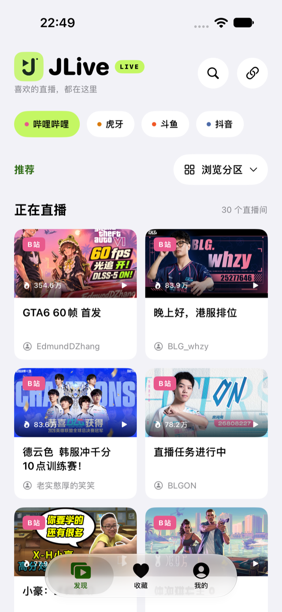
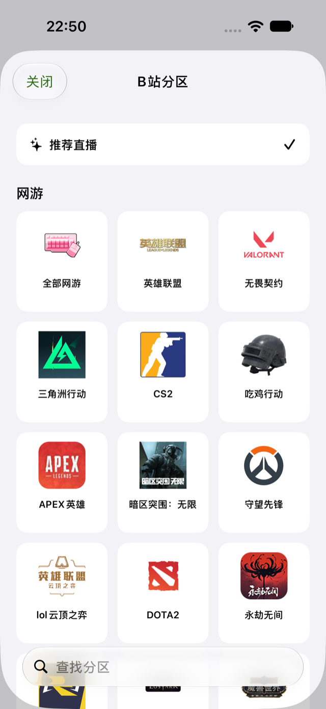
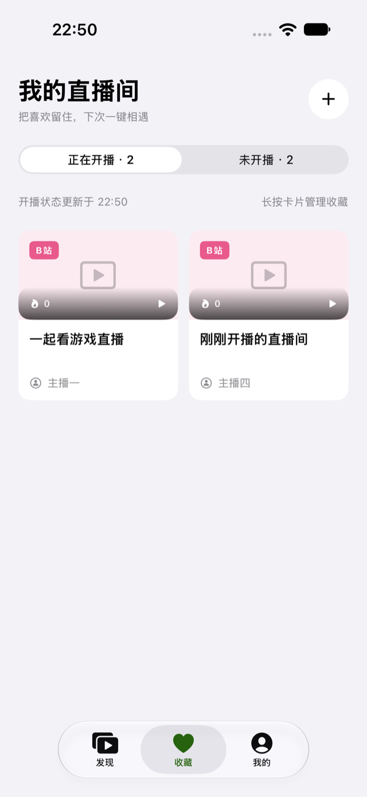
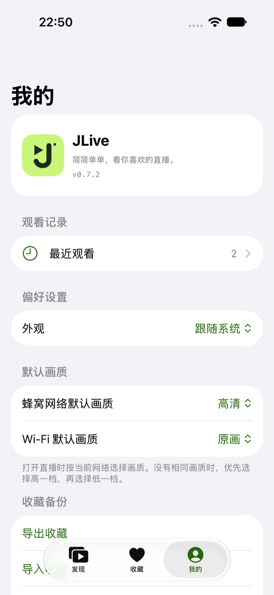

# JLive

简简单单，看你喜欢的直播。

JLive 是一款 iPhone 聚合直播应用，把哔哩哔哩、虎牙、斗鱼和抖音放在一起，免登录浏览、观看和收藏。支持 iOS 17 及更新版本。

[下载最新版](https://github.com/nembx/JLive/releases/latest)

## 软件截图

<table>
  <tr>
    <th>发现直播</th>
    <th>浏览分区</th>
  </tr>
  <tr>
    <td></td>
    <td></td>
  </tr>
  <tr>
    <th>我的收藏</th>
    <th>观看偏好</th>
  </tr>
  <tr>
    <td></td>
    <td></td>
  </tr>
</table>

截图来自 iPhone 模拟器，收藏页使用示例直播间展示开播筛选。

## 主要功能

- **多平台浏览**：切换哔哩哔哩、虎牙、斗鱼和抖音，查看推荐直播，下拉刷新或加载更多。
- **分区与搜索**：按游戏、音乐等分区寻找直播，支持搜索分区名称；可以搜索 B站、虎牙和斗鱼的直播间，抖音通过推荐、链接或房间号打开。
- **直播播放**：支持画质与线路切换、播放与暂停、静音、画中画和 AirPlay。横屏画面上下贴边，切换全屏时继续播放。
- **自适应布局**：窄屏时视频在上、聊天在下；展开后的宽屏横向显示时，视频和聊天左右排列，调整窗口大小时保留同一个播放器。
- **默认画质**：分别设置蜂窝网络和 Wi-Fi 打开直播时的画质，可选流畅、标清、高清、超清、蓝光和原画。缺少同档画质时，优先选择最近的更高档，再选择最近的更低档。
- **实时弹幕**：四个平台均支持画面弹幕和聊天列表。已显示的弹幕完整走到左侧、全部移出画面后再消失；支持调整字号、不透明度、速度、显示区域和屏蔽词。
- **收藏与开播状态**：收藏喜欢的直播间，按“正在开播”和“未开播”筛选。打开收藏页时自动更新开播状态，也可以下拉刷新。
- **收藏备份**：导出或导入收藏文件，导入时合并去重，可通过 iCloud 云盘保存或迁移到另一台设备。
- **最近观看**：在“我的”页查看最近打开的直播间，支持清空记录。
- **外观与分享**：支持跟随系统、浅色和深色外观，以及直播间链接打开和分享。

收藏、观看记录和偏好设置保存在本机。JLive 无需平台账号；直播暂时无法播放时，可通过直播间内的入口前往平台官网观看。

## 开源与致谢

JLive 参考 [Simple Live](https://github.com/xiaoyaocz/dart_simple_live)，平台适配与弹幕协议参考并改写自该项目（Copyright © 2023–2025 xiaoyaocz）。

本项目按 [GPL-3.0-or-later](LICENSE) 开源，应用内也可查看开源许可。
